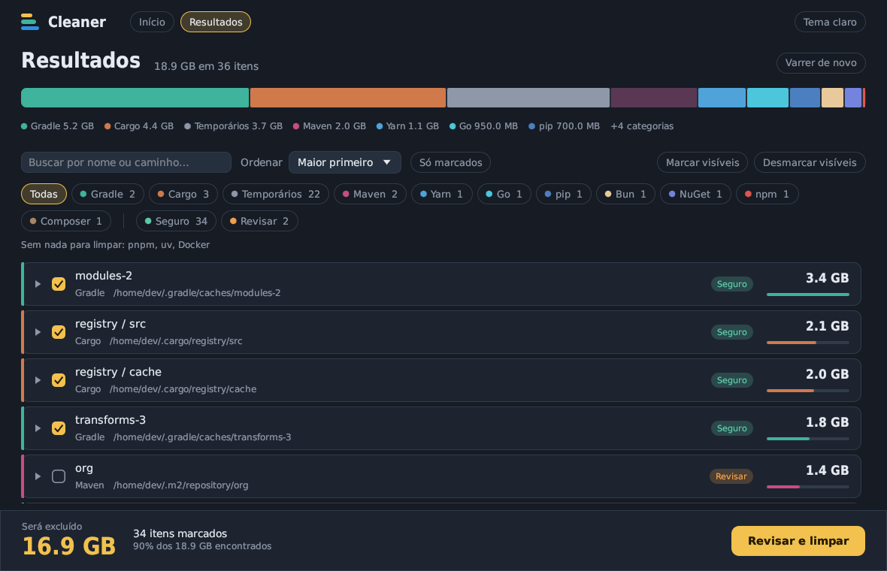
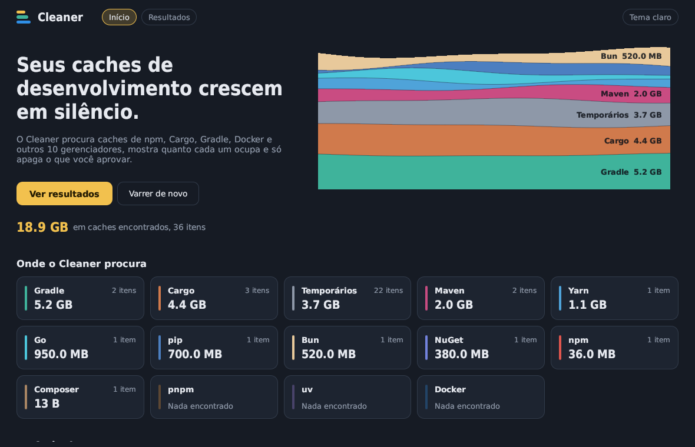
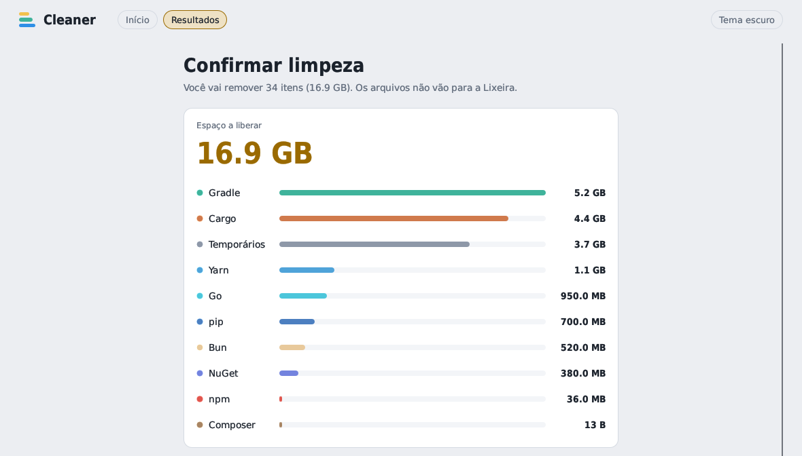
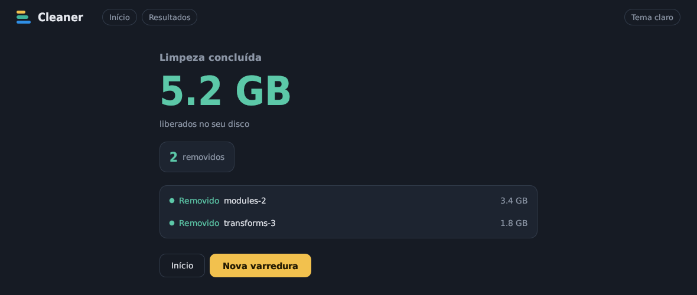

# Cleaner

Um app de desktop que encontra os caches que ferramentas de desenvolvimento deixam pelo disco (npm, Cargo, Gradle, Docker e mais 10), mostra quanto cada um ocupa e só apaga o que você aprovar.



Feito em Rust com [egui](https://github.com/emilk/egui). Roda principalmente no Windows, mas também compila para Linux e macOS.

## Por que existe

Cada gerenciador de pacotes guarda o próprio cache, num lugar diferente, e nenhum deles limpa sozinho. Depois de alguns anos é comum ter dezenas de GB em `~/.gradle`, `~/.cargo/registry`, `~/.m2` e na pasta temporária do sistema sem perceber. O Cleaner junta tudo numa tela só e deixa você decidir item por item.

## Como funciona

1. **Varredura.** As 14 categorias são verificadas em paralelo, e os resultados aparecem conforme vão sendo encontrados.
2. **Revisão.** A lista vem do maior para o menor. Dá para abrir pastas, marcar e desmarcar itens, filtrar e reordenar. O rodapé mostra sempre o total exato que vai ser excluído.
3. **Confirmação.** Antes de apagar, uma tela resume o espaço que vai ser liberado em cada categoria e avisa se há itens marcados como **Revisar**.
4. **Relatório.** No fim aparece o espaço liberado e o resultado de cada item: removido, ignorado ou com falha, e por quê.

| Início | Confirmação |
| --- | --- |
|  |  |



## O que ele procura

| Categoria | Onde | Como apaga |
| --- | --- | --- |
| npm | `npm config get cache` (`_cacache`) | `npm cache clean --force` |
| Yarn | Cache do Yarn Classic e do Berry | Arquivos do cache |
| pnpm | Store do pnpm | `pnpm store prune` |
| Bun | `~/.bun/install/cache` | Arquivos do cache |
| pip | Cache de wheels e sdists | Arquivos do cache |
| uv | Cache do uv | Arquivos do cache |
| Cargo | `$CARGO_HOME/registry` e `git` | Pastas do cache |
| Gradle | `$GRADLE_USER_HOME/caches` | Pastas do cache |
| Maven | `~/.m2/repository` | Pastas, marcadas como **Revisar** |
| Go | `GOCACHE` e `pkg/mod` | `go clean -cache` e pastas de módulos |
| NuGet | `~/.nuget/packages` | Pastas de pacotes |
| Composer | `composer config cache-dir` | Arquivos do cache |
| Docker | Imagens soltas, containers parados, volumes órfãos e cache de build | Comandos `docker` |
| Temporários | `TEMP`, `TMP`, `TMPDIR` | Só itens mais velhos que a idade mínima configurada (7 dias por padrão) |

Se uma ferramenta não está instalada ou não tem cache, a categoria aparece como "Nada encontrado".

## Segurança

Um app que apaga arquivos precisa ser conservador. As regras são estas:

- **Nada é apagado sem confirmação.** A varredura só lê o disco.
- **Cada item tem um nível de risco.**
  - **Seguro**: a ferramenta baixa de novo quando precisar. Começa marcado.
  - **Revisar**: pode conter algo que você ainda usa, como artefatos Maven instalados localmente ou volumes Docker órfãos (que podem ter dados de banco). Começa desmarcado.
  - **Bloqueado**: não pode ser selecionado, por exemplo containers Docker em execução.
- **Tudo fica restrito à raiz do cache.** Antes de remover qualquer caminho, o core resolve o caminho real (seguindo `..` e links) e recusa se ele sair da raiz da categoria ou cair em pastas do sistema (`System32`, `Program Files`, `/usr/bin`, `/etc` etc.). Links simbólicos não são seguidos na varredura.
- **Quando a ferramenta tem um comando próprio de limpeza, ele é usado** em vez de apagar arquivos à mão (npm, pnpm, Go e Docker).
- **O que você vê é o que sai.** Uma pasta totalmente marcada é removida inteira. Uma pasta parcialmente marcada só perde os filhos marcados. Uma pasta e um item de dentro dela nunca entram juntos na conta, então o total mostrado não conta nada duas vezes.

Os arquivos apagados **não vão para a Lixeira**.

## Usando a tela de resultados

- **Ordenar:** maior primeiro (padrão), menor primeiro, nome A–Z ou Z–A, categoria ou risco.
- **Filtrar:** por uma ou várias categorias, por nível de risco, por texto (nome ou caminho) e por "Só marcados". Clicar numa faixa da barra colorida filtra aquela categoria.
- **Marcar em lote:** "Marcar visíveis" e "Desmarcar visíveis" valem só para o que o filtro atual mostra.
- **Detalhes:** passe o mouse sobre um item para ver por que ele foi encontrado, o que o nível de risco significa e a data de modificação.

## Compilando

Você precisa do Rust estável (1.82 ou mais novo) instalado pelo [rustup](https://rustup.rs).

```sh
git clone <url-do-repositório>
cd cleaner
cargo run --release -p cleaner
```

O executável fica em `target/release/cleaner` (`cleaner.exe` no Windows). Nas builds release do Windows o app abre sem janela de console.

No Linux, o eframe precisa das bibliotecas de desenvolvimento de X11/Wayland e OpenGL. No Debian/Ubuntu:

```sh
sudo apt install libxkbcommon-dev libgl1-mesa-dev libxcursor-dev libxrandr-dev libxi-dev
```

### Testes

```sh
cargo test
```

## Preferências

A idade mínima dos temporários e o tema (claro ou escuro) ficam salvos em `settings.json`:

| Sistema | Caminho |
| --- | --- |
| Windows | `%APPDATA%\cleaner\cleaner\config\settings.json` |
| Linux | `~/.config/cleaner/settings.json` |
| macOS | `~/Library/Application Support/dev.cleaner.cleaner/settings.json` |

## Estrutura do projeto

```
crates/
├── core/            # cleaner-core: varredura, seleção e exclusão, sem UI
│   └── src/
│       ├── scanners/   # um módulo por categoria (npm.rs, cargo.rs, docker.rs, …)
│       ├── scan/       # orquestra os scanners em threads
│       ├── tree.rs     # árvore de resultados, seleção, filtros e ordenação
│       ├── delete.rs   # execução da limpeza
│       ├── safety.rs   # validação de caminhos antes de apagar
│       └── settings.rs
└── app/             # cleaner: interface em egui
    └── src/
        ├── app.rs      # telas e fluxo
        ├── theme.rs    # paleta, fontes e componentes desenhados à mão
        └── i18n.rs     # textos da interface
```

O core não depende da interface, então dá para usá-lo em outra UI ou numa CLI.

## Contribuindo

Contribuições são bem-vindas: issues, correções e novos scanners.

Para adicionar uma categoria:

1. Crie `crates/core/src/scanners/<nome>.rs` com uma função `scan` que envia `ScanNode`s pelo canal. Use `path_node` e `list_children` de `common.rs`.
2. Adicione a variante em `Category` (`model.rs`) e registre-a em `Category::all()` e em `scanners::run_category`.
3. Se os itens puderem ser abertos, implemente `expand` e registre em `scanners::expand_node`.
4. Dê um nome à categoria em `i18n::category_name` e uma cor em `theme::category_color`.
5. Escolha o risco com cuidado. Na dúvida, use `Risk::Review` e `default_selected: false`.

Antes de abrir um PR, rode `cargo test` e `cargo clippy`.

## Licença

Distribuído sob a licença MIT. Veja o arquivo [LICENSE](LICENSE).
