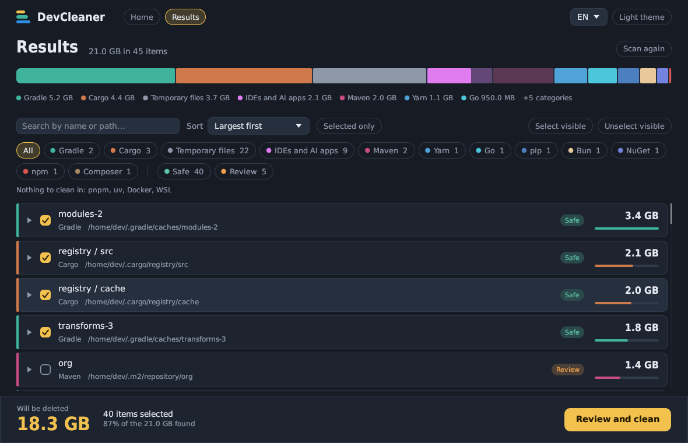
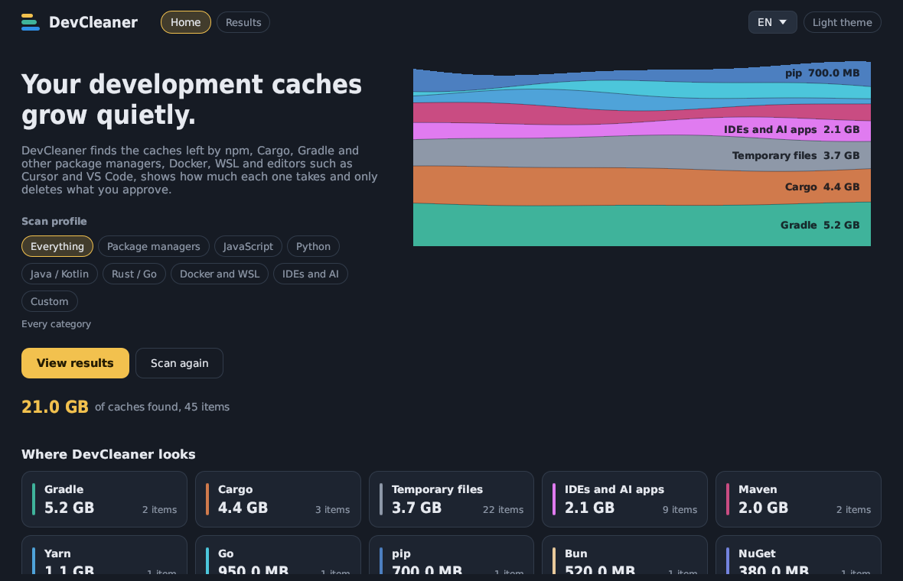
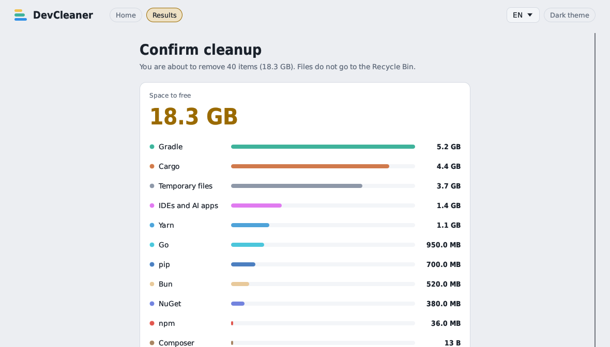
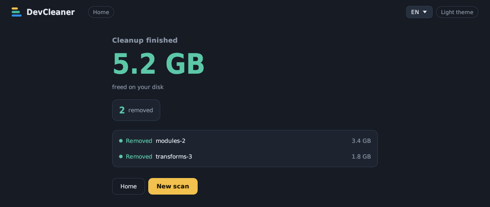

# DevCleaner

A desktop app that finds the caches development tools leave on your disk (package managers, Docker, WSL, code editors and AI apps), shows how much each one takes and only deletes what you approve.



Built in Rust with [egui](https://github.com/emilk/egui). Windows is the main target, and it also builds on Linux and macOS. The interface is available in English, Portuguese and Spanish.

## Why

Every package manager keeps its own cache in its own place, and none of them cleans up after itself. After a few years it is common to have tens of GB sitting in `~/.gradle`, `~/.cargo/registry`, `~/.m2` and the system temp folder without noticing. DevCleaner puts all of it on one screen and lets you decide item by item.

## How it works

1. **Scan.** Pick a [scan profile](#scan-profiles) or scan everything. Categories are checked in parallel, and results show up as they are found.
2. **Review.** The list comes sorted from largest to smallest. You can open folders, select and unselect items, filter and sort. The footer always shows the exact total that will be deleted.
3. **Confirm.** Before deleting, a screen sums up the space each category will free and warns you if any selected item is marked **Review**.
4. **Report.** At the end you see the space freed and what happened to each item: removed, skipped or failed, and why.

| Home | Confirmation |
| --- | --- |
|  |  |



## What it looks for

| Category | Where | How it deletes |
| --- | --- | --- |
| npm | `npm config get cache` (`_cacache`) | `npm cache clean --force` |
| Yarn | Yarn Classic and Berry caches | Cache files |
| pnpm | pnpm store | `pnpm store prune` |
| Bun | `~/.bun/install/cache` | Cache files |
| pip | Wheel and sdist cache | Cache files |
| uv | uv cache | Cache files |
| Cargo | `$CARGO_HOME/registry` and `git` | Cache folders |
| Gradle | `$GRADLE_USER_HOME/caches` | Cache folders |
| Maven | `~/.m2/repository` | Folders, marked **Review** |
| Go | `go env GOCACHE` and `go env GOMODCACHE` | `go clean -cache` and `go clean -modcache` |
| NuGet | `~/.nuget/packages` | Package folders |
| Composer | `composer config cache-dir` | Cache files |
| Docker | Docker Desktop virtual disk, dangling and unused images, stopped containers, orphan volumes and build cache | `docker` commands; the virtual disk is [compacted](#docker-and-wsl-virtual-disks); unused images, stopped containers and orphan volumes are marked **Review** |
| WSL | Virtual disk of each distro, and dev caches inside running distros | Cache folders inside the distro; the virtual disk is [compacted](#docker-and-wsl-virtual-disks) |
| IDEs and AI apps | Cursor, VS Code, VSCodium, Windsurf, Antigravity, Trae, Kiro, Claude desktop and Claude Code | Cache, log and update folders; workspace state, Cursor's code index and Claude Code history are marked **Review** |
| Temporary files | `TEMP`, `TMP`, `TMPDIR` | Only items older than the configured minimum age (7 days by default) |

If a tool is not installed or has no cache, its category shows "Nothing found".

### Docker and WSL virtual disks

On Windows, Docker Desktop and every WSL distro keep their files inside a virtual disk (`.vhdx`). The file grows as images, containers and Linux files are written, but **it never shrinks on its own**: after deleting 30 GB of images, the disk still takes 30 GB on Windows. That is why Docker can take so much space even after months without use.

DevCleaner lists these disks, including Docker Desktop's when it is closed and when its disk was moved to another drive (Settings > Resources > Advanced > Disk image location). Selecting a disk **compacts** it:

1. Items deleted in the same cleanup are removed first (for example images or caches inside a distro), so their space can be reclaimed.
2. WSL is shut down with `wsl --shutdown`, which also stops Docker Desktop. Save anything open in WSL before.
3. `diskpart` attaches each disk read-only and runs `compact vdisk`. Windows asks for administrator permission once for all selected disks.
4. The report shows how much each disk actually shrank.

Compacting reads the whole disk, so it can take a while: from a few minutes on an SSD to half an hour or more for a large disk on a hard drive. The confirmation screen shows an estimated time based on the disk size, and while it runs DevCleaner shows the progress reported by `diskpart` (or the elapsed time, when that is not available). Do not close DevCleaner or turn off the computer until it finishes.

Nothing inside the disks is deleted. Compacting only gives back blocks that are already free.

For the best result, free space inside first: delete unused Docker images and build cache (or run `docker system prune`) and the caches inside your distros, then compact in the same cleanup or the next one.

Disks converted to sparse files (`wsl --manage <distro> --set-sparse true`) may refuse to be compacted; when that happens the report shows the disk as failed.

## Scan profiles

A profile limits the scan to the categories you care about. It is chosen on the home screen and saved in Preferences.

| Profile | Categories |
| --- | --- |
| Everything | All categories |
| Package managers | npm, Yarn, pnpm, Bun, pip, uv, Cargo, Gradle, Maven, Go, NuGet, Composer |
| JavaScript | npm, Yarn, pnpm, Bun |
| Python | pip, uv |
| Java / Kotlin | Gradle, Maven |
| Rust / Go | Cargo, Go |
| Docker and WSL | Docker, WSL |
| IDEs and AI | IDEs and AI apps |
| Custom | The categories you click on the home screen |

## Safety

An app that deletes files has to be conservative. These are the rules:

- **Nothing is deleted without confirmation.** Scanning only reads the disk.
- **Every item has a risk level.**
  - **Safe**: the tool downloads or rebuilds it when needed. Starts selected.
  - **Review**: may hold something that only exists there, such as Maven artifacts installed locally with `mvn install`, stopped Docker containers (`docker rm` discards anything written inside them outside volumes), orphan Docker volumes (which may hold database data), Cursor's AI chat history or Claude Code conversations. Virtual disks are also Review, because compacting them shuts WSL down. Always starts unselected, whatever the scanner says.
  - **Blocked**: cannot be selected, for example running Docker containers.
- **Everything stays inside the cache root.** Before removing a path, the core resolves its real location (following `..` and links) and refuses if it leaves the category root or lands in system folders (`System32`, `Program Files`, `/usr/bin`, `/etc` and so on). Symbolic links are not followed while scanning.
- **When a tool has its own cleanup command, that command is used** instead of deleting files by hand (npm, pnpm, Go and Docker).
- **What you see is what gets deleted.** A fully selected folder is removed as a whole. A partially selected folder only loses its selected children. A folder and an item inside it are never counted together, so the total shown never counts anything twice.

Deleted files **do not go to the Recycle Bin or Trash**.

### What can go wrong

Deleting caches marked **Safe** should only cost time: the next build downloads and compiles everything again. Keep in mind:

- Re-downloading needs internet access, and dependencies from private feeds (NuGet, npm, Go with `GOPRIVATE`) need your credentials set up.
- Offline builds (`gradle --offline`, `cargo --offline`) fail until the cache is filled again.
- A version pinned in a lockfile that was later removed from its registry cannot be downloaded again.
- Close IDEs, AI apps and running builds before cleaning. Files they hold open fail to delete and show up as "Failed" in the report.

## Using the results screen

- **Sort:** largest first (default), smallest first, name A–Z or Z–A, category or risk.
- **Filter:** by one or more categories, by risk level, by text (name or path) and by "Selected only". Clicking a segment of the colored bar filters that category.
- **Bulk selection:** "Select visible" and "Unselect visible" only apply to what the current filter shows.
- **Details:** hover an item to see why it was found, what its risk level means and when it was last modified.

## Languages

DevCleaner speaks English, Portuguese (pt-BR) and Spanish. On first run it follows the operating system language, falling back to English. You can switch at any time from the language menu in the top bar or in Preferences, and the whole screen updates immediately, including results you already scanned.

Sizes follow the language: `1.5 GB` in English, `1,5 GB` in Portuguese and Spanish.

## Building

You need stable Rust (1.82 or newer), installed with [rustup](https://rustup.rs).

```sh
git clone <repository-url>
cd cleaner
cargo run --release -p cleaner
```

The executable ends up in `target/release/cleaner` (`cleaner.exe` on Windows). Release builds on Windows open without a console window.

On Linux, eframe needs the X11/Wayland and OpenGL development libraries. On Debian/Ubuntu:

```sh
sudo apt install libxkbcommon-dev libgl1-mesa-dev libxcursor-dev libxrandr-dev libxi-dev
```

### Tests

```sh
cargo test
```

## Preferences

The scan profile, the minimum age of temporary files, the theme (light or dark) and the language are saved in `settings.json`:

| System | Path |
| --- | --- |
| Windows | `%APPDATA%\cleaner\cleaner\config\settings.json` |
| Linux | `~/.config/cleaner/settings.json` |
| macOS | `~/Library/Application Support/dev.cleaner.cleaner/settings.json` |

## Project layout

```
crates/
├── core/            # cleaner-core: scanning, selection and deletion, no UI
│   └── src/
│       ├── scanners/   # one module per category (npm.rs, docker.rs, wsl.rs, ide.rs, …)
│       ├── scan/       # runs the scanners in threads
│       ├── tree.rs     # result tree, selection, filters and sorting
│       ├── delete.rs   # runs the cleanup
│       ├── safety.rs   # path checks before deleting
│       ├── i18n.rs     # languages and every text the core produces
│       ├── profiles.rs # scan profiles
│       └── settings.rs
└── app/             # cleaner: egui interface
    └── src/
        ├── app.rs      # screens and flow
        ├── theme.rs    # palette, fonts and hand-drawn components
        └── i18n.rs     # interface texts
```

The core does not depend on the interface, so it can back another UI or a CLI.

## Contributing

Contributions are welcome: issues, fixes, new scanners and translation fixes.

### Adding a category

1. Create `crates/core/src/scanners/<name>.rs` with a `scan` function that sends `ScanNode`s through the channel. Use `path_node` and `list_children` from `common.rs`.
2. Add the variant to `Category` (`model.rs`) and register it in `Category::all()` and `scanners::run_category`.
3. If its items can be opened, implement `expand` and register it in `scanners::expand_node`.
4. Give the category a name in `app/src/i18n.rs` (`category_name`) and a color in `theme::category_color`, and add it to the matching profiles in `core/src/profiles.rs`.
5. Add its texts (reasons, "not found" message) to `Msg` in `core/src/i18n.rs`, in all three languages.
6. Pick the risk carefully. When in doubt, use `Risk::Review`.

### Texts and translations

User-facing text never lives as a plain string in the code:

- **Core** texts are `Msg` variants in `crates/core/src/i18n.rs`. Scanners store a `Text` (a message, a message with an argument, or raw data such as a file name), and it is translated only when displayed.
- **Interface** texts are functions in `crates/app/src/i18n.rs`.

Both use `pick(pt, es, en)`, so a missing translation is a compile error. For now DevCleaner supports only these three languages.

Before opening a PR, run `cargo test` and `cargo clippy`. Notable changes go in [CHANGELOG.md](CHANGELOG.md).

## License

Released under the MIT license. See [LICENSE](LICENSE).
